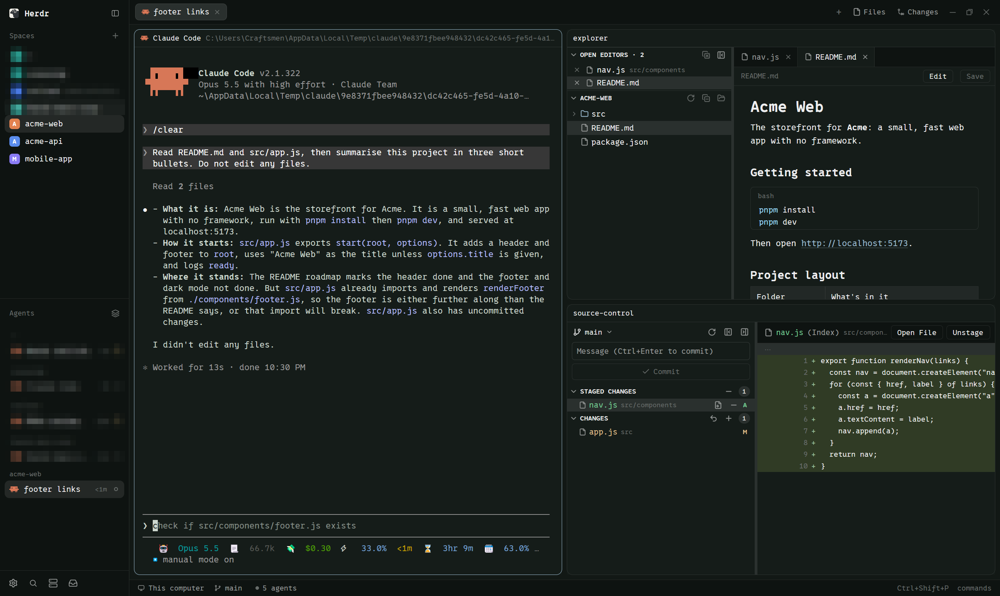
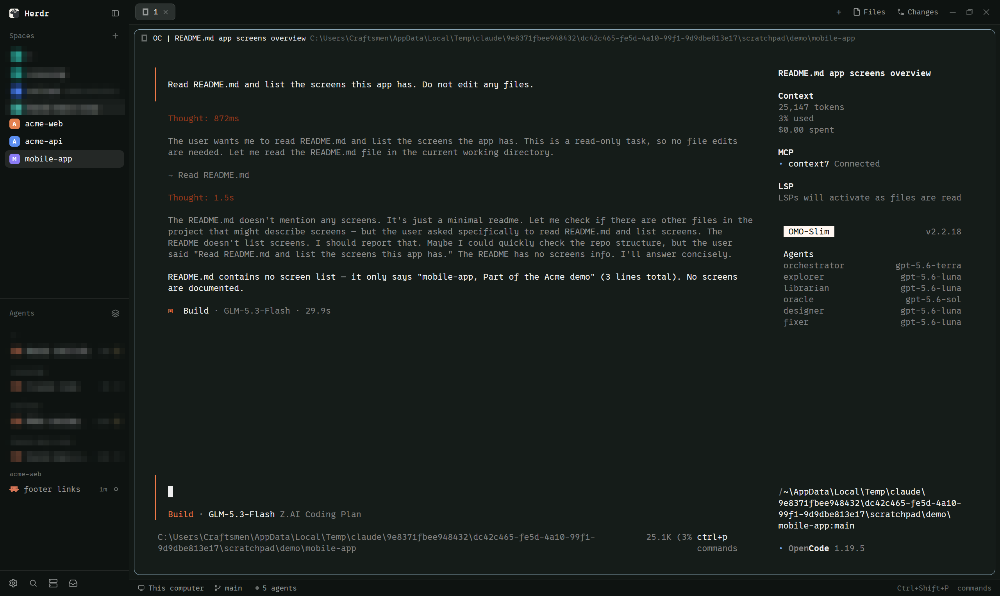
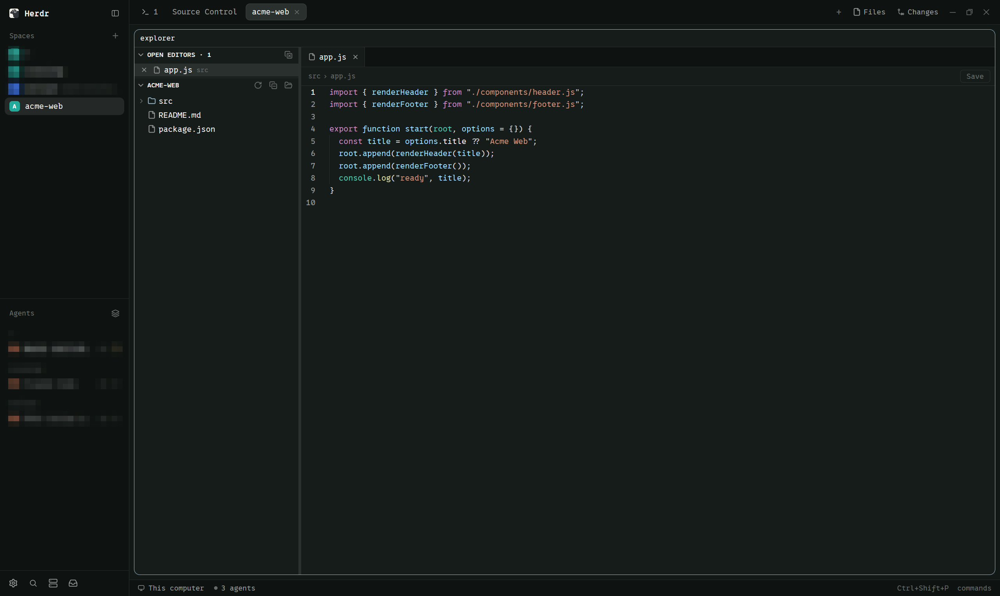

# Mars Corp

A [Herdr](https://herdr.dev) layout for working in a repository the way you would in VS Code:

- **File explorer**: an IDE-style folder tree (filetree, with Material Icon Theme icons and git status), editor tabs with syntax colours, Markdown preview, and Save (no autosave).
- **Source Control**: changed files, side-by-side or inline diffs, stage, unstage, discard and commit. After a commit, the button becomes Publish Branch or Sync Changes, as in VS Code.
- **Branch picker**: click the branch name in Source Control or in the status bar. You can search, check out a branch or tag, or create a new branch.
- **Inbox**: T3's Inbox as a second view of the sidebar, one click from the footer.
- **Transfers**: in a space on another machine, right-click a file in the tree and pick Download to Mac (it lands in `~/Downloads`), or drag files from Finder onto the tree to upload them into the selected folder. A bar in the tree's footer shows how far it got.

Each space holds its own agents. Here OpenCode works in a second space:

## Install

Ask the agent in your Herdr terminal:

> Read ~/.config/herdr-app/AGENTS.md, then add this layout: https://github.com/mdmuaj13/herdr-mars-corp

Then switch to it with Ctrl+Shift+L, or in Settings → Look.

To install by hand instead, copy `layouts/` and `mods/` into `~/.config/herdr-app/`, and merge `keys.json` into yours. Then run `herdr-app check` on each mod.

The explorer's tree and the Files side panel come from the `filetree` mod, which takes its icons from `file-icons`. Install both with the rest of `mods/`.

Optional: `mods/filetree/bridge.ts` is a Claude Code hook (run with `bun`) that makes Claude's reads, writes and git actions light up in the tree. It appends to `~/.local/state/herdr-filetree/activity.jsonl`. Without it the tree works normally, with no activity highlights.

## What it runs

- **Source Control** and the branch picker run `git` in the repositories you open: status, diff, add, restore, clean, commit, push, pull, checkout and for-each-ref. Push and pull use your own git login (credential manager or ssh keys).
- **File explorer** reads folders itself, falling back to PowerShell on Windows or `sh` elsewhere for a folder outside your home folder or on another machine. It runs `git status` and `git check-ignore` to colour changed and ignored files. It reads files, and writes a file only when you press Save.
- **filetree** runs `git` (read-only, without taking git's index lock) for status and line counts, and `mkdir -p ~/.local/state/herdr-filetree` to watch for the optional hook's activity file.
- **Transfers** (both trees) run `sh` with `hc exec --on <machine>`, `gzip`, `gunzip`, `base64`, `tail`, `head`, `wc`, `cat`, `test`, `mv` and `rm`, on this computer and on the space's machine. The bytes go through Herdr's own connection to that machine, so there is no ssh setup. A download writes only into `~/Downloads`; an upload writes only into the folder it was dropped on.

It makes no network requests of its own.

## Licence and credits

Mars Corp is by Mohaiminul Hassan ([@mdmuaj13](https://github.com/mdmuaj13)), released under the MIT licence (`LICENSE`). The parts below come from others and keep their own licences.

- The layout started as a copy of [herdr-skillshare](https://github.com/runkids/skillshare) by runkids (MIT, `licenses/skillshare-LICENSE.txt`).
- `t3-inbox`, `t3-new-menu` and `t3-picker` come from [herdr-t3](https://github.com/JinJieBeWater/herdr-t3) by JinJieBeWater, unchanged (Apache-2.0, `licenses/herdr-t3-LICENSE.txt`).
- `mars-chrome`, `mars-status`, `mars-pane`, `tabs-plus` and `new-menu-plus` are edited copies of mods that ship with Herdr.
- `filetree` is a port of claude-code-filetree by Kurt Buhler (MIT). `mars-explorer/filetree.js` is an embedded copy of its view.
- `file-icons` is a modified copy of Herdr's shipped `files` mod (Apache-2.0). Its icons, also used by `filetree`, come from [Material Icon Theme](https://github.com/material-extensions/vscode-material-icon-theme) (MIT, `mods/file-icons/LICENSE-material-icon-theme.txt`).
- The icons are from [Lucide](https://lucide.dev) (ISC).

See `RECIPE.md` for a full description, written so that an agent can rebuild the layout from scratch.
