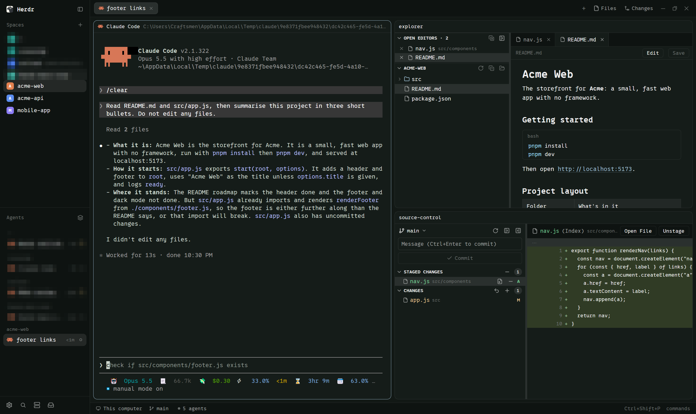

# Mars Corp

A Herdr layout for working in a repository the way you would in VS Code. It keeps Herdr's sidebar of spaces and agents, and adds T3's Inbox as a second view of that sidebar. The + menu opens a VS Code style **File explorer** (a tree, editor tabs, syntax colours, Save) and a **Git** tab (the Source Control mod) (changed files, side-by-side diffs, stage, commit, then Publish or Sync). The bottom status bar shows the current branch, and clicking it opens a searchable branch picker that can check out a branch or tag, or create a new branch.

By Mohaiminul Hassan ([@mdmuaj13](https://github.com/mdmuaj13)), MIT.

## What you see

Left to right, with a 1px `border` divider; the root background is `canvas`, there is no system title bar, and terminals are padded 14 × 12:

- **Sidebar** (268px, min 44, max 480, `chrome`, not resizable by drag), top to bottom:
  - **Brand bar** (46px, drags the window; `mars-chrome`): Herdr's mark (20px, radius 5) and `Herdr` in semibold `foreground`, then a 26px sidebar toggle at the right. Below 160px wide (the rail) only the toggle shows. It has no search button: Search is in the footer.
  - **Views** (a stack, `sidebar-lists`), one at a time:
    - `lists`: Herdr's shipped `spaces` and `agents`, split 1:1, each at least 90px.
    - `inbox`: T3's Inbox (`t3-inbox`): a search button, a space filter, New space and New tab at the top, then cards for the agents that need you, and folded Working, Snoozed and Settled shelves.
  - **Footer** (44px, `mars-chrome` with `footer: true`, 1px `border` on top): one row of 30px icon buttons, 4px apart, radius 8, with 16px icons in `muted` (`foreground` and `hover` on hover), each with a tooltip:
    1. Settings (`settings.svg`). It carries a 6px `accent` dot in its top right corner once Herdr has downloaded an update.
    2. Search (`search.svg`), Herdr's Go to.
    3. Add machine (`server-rack.svg`, a two-unit server rack).
    4. Show inbox or Show lists (`inbox.svg` or `layout-list.svg`): the view a click switches to.
    On the rail only Settings shows.
- **Work column**:
  - **Tab bar** (42px, drags the window; `tabs-plus`): the active space's tabs as 29px pills (radius 7, 12.8px text, the active one `raised` with a `border`), each with its program icon, a spinner while working, a 6px dot when blocked or done, and a close × on the active one. Double-click renames, drag reorders, right-click opens Herdr's `menu`, and the wheel switches tabs. At the right: `+` (opens the + menu below), `Files` and `Changes` (Herdr's side panels, remembered per space) and, on Windows and Linux, minimize, maximize/restore and close.
  - **Panes** (padding 8, gap 8): the active tab, each pane a card with radius 10, `background` fill, a 1px `border` (`accent` when focused), framed even when alone, and Herdr's `pane` header (30px, on top, always shown).
  - **Side panel** (368px, min 280, max 900, hidden until `Files` or `Changes` opens it): `filetree` (files) and Herdr's `changes` in a stack.
  - **Status bar** (28px, `chrome`, 1px `border` on top, 11.8px `muted`; `mars-status`): `This computer` (or the machine), the **branch** (a 13px branch icon and the name; a 20px button, radius 4, `hover` on hover), the agent count with `· n needs you` in `blocked`, and at the right the command palette's key.
- **+ menu** (a popup, 250 × 574; `new-menu-plus`): Terminal, **File explorer**, **Git** (opens Source Control in a tab named Git), then the installed agents (keys 1–9), New space, New worktree…, Open worktree…. The File explorer and Git rows end in two 22px buttons (radius 5, 13px `dim` icons from the shipped `pane` mod): split right and split down.

### File explorer (`mars-explorer`, a tab)

- **Sidebar toggle** (the same in Source Control): a 22px button (radius 4, 15px icon) with tooltip `Hide sidebar (Ctrl+B)` or `Show sidebar (Ctrl+B)`. While the sidebar shows, it sits at the right end of the sidebar's top row (here the OPEN EDITORS header, after its own actions; in Source Control, after Refresh), as Lucide `panel-left-close`. While the sidebar is hidden, it is alone at the top of a 30px rail (`surface`, 1px `border` on its right), as `panel-left-open`; nothing else takes room.
- **Left** (a draggable splitter, 160–640px): `OPEN EDITORS · n` (each open file, × to close, a button to close all), then the folder tree: an embedded copy of the `filetree` mod's view (`mars-explorer/filetree.js`). It has Material Icon Theme icons (from `file-icons`), git status colours with line and file counts, a branch row, search across unopened folders, a date or size column, keyboard navigation, and the optional Claude activity highlights. One click on a file inside the root opens it in the editor; a file outside the root is previewed by the tree. The tree lists and watches the folder itself, so the explorer adds no refresh or collapse-all buttons of its own.
- **Right**: one 34px tab per open file (a ● while it has unsaved edits, × to close), a breadcrumb row with **Save**, then the editor: 13px code, 20px lines, line numbers, folding, VS Code's Dark+ (or Light+) colours. Markdown opens as a rendered preview with an **Edit** button (and **Preview** to go back); its code blocks are coloured by their language. JSON, `.env` files, YAML, Dockerfiles and the usual languages are coloured; TypeScript uses the JavaScript colours and TOML uses YAML's.

### Source Control (`source-control`, a tab)

- **Left panel** (draggable, 220–640px):
  - **Header**: the branch as a button (branch icon, name, ▾) that opens the branch picker below it; then Pull, Push and Refresh icons. Pull shows once the branch has an upstream; Push shows when the repository has a remote.
  - **Commit box**: a message field (grows to 6 lines) and one primary button that changes with the repository, as VS Code's:
    - `✓ Commit` while something is staged, or `✓ Commit All` when only unstaged changes exist. It needs a message.
    - `Publish Branch` once everything is committed on a branch that has never been pushed.
    - `Sync Changes 1↓ 2↑` once everything is committed and the branch is behind or ahead of its upstream.
    - Otherwise a disabled `Commit`.
  - Strips for a confirm (Discard), an error (Dismiss) or a notice (OK).
  - **Sections**: MERGE CHANGES, STAGED CHANGES and CHANGES (the first two only when they have files), each folding, with a count and section actions (Stage All, Unstage All, Discard All). Rows: file name coloured by status, its folder dimmed, a status letter (M, A, D, U, !), and on hover Open File, Discard, Stage or Unstage.
- **Diff toggle**: a second 22px button after the sidebar's, Lucide `panel-right-close` (`Hide diff`) or `panel-right-open` (`Show diff`). Hidden, the left panel takes the whole width (handy in a narrow split).
- **Diff** (right): a toolbar (file, where it is, Side by side / Inline, Open File, Discard, Stage / Unstage / Mark Resolved), then the diff in 12px rows with VS Code's colours (added `#9bb95533`, removed `#ff000033`). Side by side pairs removed lines with the lines that replaced them; long lines are cut with "…".

### Branch picker

From the panel's branch name (a popover under it) or the status bar's branch (a 420 × 422 popup just above the bar): a title, a search field, then 26px rows, 12 at a time, with a thin position bar and the wheel to scroll:

- `+ Create new branch…`, or `+ Create new branch "<typed text>"` once something is typed.
- `+ Create new branch from…`
- Local branches, then remote branches, then tags, newest commit first within each, each row with its icon (branch, cloud, tag), name, and `Branch · abc1234 · 2 days ago`. The current branch is in `accent` and says `current`.
- Below, a hint: `↑↓ to move · Enter to choose · Esc to close`.

## How it behaves

- **Sidebar views**: the footer's last icon runs `layout.select {stack: "sidebar-lists", child: "inbox" | "lists"}`; its icon and tooltip name the view it switches to.
- **Search** (footer) runs `mod.open {name: "picker"}`, Herdr's Go to. The Inbox's own search button opens `t3-picker`.
- **Add machine** runs `mod.open {name: "machine-add"}`. **Settings** runs `app.settings`.
- **+ menu → File explorer / Git**: a click on the row opens a tab with that mod; its split right or split down button opens it as a pane beside the focused pane instead (`pane.split {direction, pane, mod, props}`), in the same tab. Either way it is rooted at the first of these that is neither the home folder nor a drive root: the focused pane's folder, the space's folder, then the folders of the space's other panes (its shown tab first). If none fits, it opens nothing and posts a short warning toast (`notify`): "Can't open Explorer in ~" (or "Git"). It runs on the space's machine. With no focused pane (a layout terminal block has the keyboard) the split buttons are hidden.
- **Diff toggle** (Source Control): hides or shows the diff; picking a file shows it again. The sidebar and the diff are never both hidden: hiding the sidebar brings the diff back.
- **Sidebar toggle** (both tabs): the toggle button or Ctrl+B (Cmd+B on macOS) hides or shows the left side (the tree, or the changed files) and its splitter; the main part takes the room. Each copy remembers it (`localStorage`: `treeOpen`, `panelOpen`), with its width.
- **Explorer**:
  - One click in the tree opens a file. Edits are kept until saved: **Save**, Ctrl+S (Cmd+S on macOS), or Ctrl+Shift+S to save all. There is no autosave.
  - Saving a file that changed on disk since it was opened shows a strip with `Overwrite with mine` and `Load disk version`. Closing a file with unsaved edits asks first (Save, Don't save, Cancel); closing all of them asks once (Save all, Discard all, Cancel).
  - Files from another machine, or over 400,000 characters, open read-only, with the reason shown.
  - With the embedded tree (the default), listing, git marks and the folder watch are `filetree`'s; the three points below describe `folders.js`, the explorer's own fallback lister.
  - A folder's contents are read only when it is expanded, so `node_modules` costs nothing until opened. Here a folder is read in the app with `fs.readdir` (no process); a directory link (junction or symlink, as pnpm's) reads as a file, so a name without a dot is tried as a folder. A folder outside the home folder, or on another machine, is listed with PowerShell on Windows, `sh` elsewhere.
  - Ignored entries come from one `git check-ignore -- <paths>` per refresh over the shown entries (chunked under 16,000 characters; `-z` needs `--stdin`, which `exec` lacks). An ignored folder's children aren't asked about.
  - The tree follows the disk through a folder watch (a 10-second timer for another machine). A batch of changed paths refreshes only what it touches: a shown folder whose entries changed is listed again, and the git marks when a non-ignored file or `.git/index`, `HEAD` or refs change. Changes in `node_modules`, ignored folders or git's objects wake nothing. A home folder or drive root is never watched, only refreshed by the timer: on Windows the watch covers every subfolder, so AppData and node_modules would wake it many times a second.
- **Source Control**:
  - It reads `git status` without taking git's index lock, refreshes on a folder watch (or every 10 seconds for another machine or a failed watch), and keeps the selected file selected as it moves between sections.
  - Ctrl+Enter (Cmd+Enter) commits. With nothing staged, Commit All stages every change first, as VS Code's smart commit does.
  - Discarding asks first, and says when untracked files will be deleted.
  - **Publish Branch** runs `git push -u origin <branch>` (or the first remote). **Sync Changes** runs `git pull --no-edit` when behind, then `git push`. Pull and Push in the header run those alone.
  - Push and pull use the person's own git setup (credential manager, ssh keys). Nothing can be typed in, so a remote that asks for a password fails with git's message.
- **Branch picker**:
  - Typing filters by name, ↑↓ move, Enter or a click chooses, and Esc or a click outside closes.
  - A local branch: `git checkout <branch>`. A remote branch `origin/x`: checks out local `x` if it exists, else `git checkout --track origin/x`. A tag: `git checkout --detach`, and the branch then reads `detached HEAD`.
  - Create new branch: `git checkout -b <name>` from the current commit. Create new branch from…: pick a ref, type the name, then `git checkout -b <name> --no-track <ref>`, so the new branch shows Publish Branch until it is pushed. Spaces in a name become dashes.
  - If git refuses (for example, local changes would be overwritten), its message shows and the picker stays open. There is no stash option.
- **Status bar branch**: shown when the active space is in a repository (Herdr's `spaces()[i].branch`). A click opens the picker for the repository of the focused pane's folder (else the space's) on the space's machine. The status bar's popup closes itself once a checkout or create succeeds.
- **Agent statuses** come from Herdr's shipped `agents`, `spaces`, `pane` and the tab bar: a spinner while working, a dot for blocked or done.

## Built from

- **Layout** `layouts/mars-corp.json`: root `row` (`canvas`, divider 1px `border`, `titlebar: "none"`, `traffic_lights: [12, 16]`, `terminal_padding: [14, 12]`, `preview: "layouts/mars-corp.png"`):
  - `sidebar` column (268px): `brand` block (`mars-chrome`, 46px, `window_drag`), `sidebar-lists` stack (active `lists`: `lists` column of `spaces` and `agents` blocks, weight 1 each, min 90; `inbox` block of `t3-inbox` with props `{ newMenu: "t3-new-menu", picker: "t3-picker" }`), `sidebar-footer` block (`mars-chrome`, props `{ footer: true }`, 44px).
  - `work` column: `tabs` block (`tabs-plus`, 42px, `window_drag`), `work-body` row (padding 8, gap 8) with `main` (`{ tab: "active" }` and the pane frame above) and `panel` (hidden; `panel-body` stack of `filetree` and `changes`), `status` block (`mars-status`, 28px).
- **Mods in this repo**:
  - `mars-chrome`: a clone of Herdr's `workspace-chrome` (brand bar and footer). Props: `footer`.
  - `mars-status`: a clone of Herdr's `workspace-status` with a clickable branch. It opens `source-control` as a popup with props `{ picker: true, root, on }`.
  - `tabs-plus`: a clone of Herdr's `tabs` whose `+` opens `new-menu-plus`.
  - `mars-pane`: a clone of Herdr's `pane` header (the layout's pane frame uses it). A mod pane's header shows a label instead of the mod's folder name: `source-control` as **Git**, `mars-explorer` (and `explorer`) as **Explorer**.
  - `new-menu-plus`: a clone of Herdr's `new-menu` with File explorer and Git rows.
  - `mars-explorer`: props `{ root, on, open? }` (`open`: paths to open first). Named `mars-explorer` so it can sit beside another mod called `explorer`. Files: `main.js`, `filetree.js` (the embedded tree; it keeps the name `filetree` so its icons, `config.json` and right-click menu come from the installed `filetree` mod), `filetree-icons.js` (icon lookup table), `folders.js` (folder listing with `fs.readdir`, else PowerShell on Windows or `sh`; `git status` marks; `git check-ignore`), `languages.js` (extensions to grammars, Dark+ and Light+ colours), `markdown.js` (splits a document into prose and fenced code).
  - `source-control`: props `{ root, on, picker? }`. Files: `main.js` (the tab), `git.js` (every git command), `diff.js` (unified diff to inline and side-by-side rows), `branches.js` (the branch picker).
  - `t3-inbox`, `t3-new-menu`, `t3-picker`: unchanged from [herdr-t3](https://github.com/JinJieBeWater/herdr-t3) by JinJieBeWater (Apache-2.0, `licenses/herdr-t3-LICENSE.txt`).
- **Third-party mods in this repo**:
  - `filetree`: an IDE-style file tree, a port of claude-code-filetree (MIT, Kurt Buhler). `config.json` holds its defaults; `bridge.ts` is an optional Claude Code hook (bun) that writes `~/.local/state/herdr-filetree/activity.jsonl`.
  - `file-icons`: Herdr's `files` with Material Icon Theme icons (Apache-2.0 base, icons MIT). `filetree` reads its SVGs from `mods/file-icons/icons`.
- **Herdr's shipped mods used**: `spaces`, `agents`, `pane`, `files`, `changes`, `menu`, `picker`, `machine-add`, `worktree`, and icons from `workspace-chrome`, `pane`, `files` and `changes`.
- **`herdr` calls**: `exec` (git, and PowerShell or `sh` to list folders the app can't read itself), `fs/promises` `readdir`, `readTextFile`, `writeTextFile`, `watchFolder`, `pickFolder`, `run` (`tab.new`, `layout.select`, `layout.show`, `layout.hide`, `mod.open`, `app.settings`, `tab.*`, `window.*`), `openOverlay`, `closeOverlay`, `notify`, `spaces`, `panes`, `focused`, `theme`, `settings`, `keys`, `knownAgents`, `shared`, `setShared`.
- **Programs it runs**: `git` (status, diff, add, restore, clean, rm --cached, commit, push, pull, checkout, for-each-ref, rev-parse, remote); PowerShell on Windows or `sh` elsewhere to list a folder outside the home folder or on another machine. No network requests of its own; push and pull reach the person's git remotes.
- **Keys** (`keys.json`): the `mod:t3-inbox`, `mod:t3-new-menu` and `mod:t3-picker` sections from herdr-t3, so the close keys close those popups.
- **Art**: Lucide icons (ISC), each `currentColor` so `svg()` tints them.

## Watch out

- Don't create `EditorState` in `render`; build it in handlers or `init`. Write `mod.json` with `"place": "none"` before `main.js`, or Herdr docks the new mod into the shown layout.
- This build's markdown grammar colours only punctuation and the fence's language, and the JSON grammar colours keys and values alike, so Markdown preview is the default and Edit is a plain toggle. There is no TypeScript or TOML grammar: they are mapped to JavaScript and YAML.
- `exec` has no environment option, and remote spaces have no folder watch: both mods fall back to a 10-second timer there.
- A `v_virtual_list` inside a `Popover`'s content drew no rows, so the branch picker windows its own list.
- `openOverlay` called from `render` is ignored; open overlays from events (`on_mouse_down`) or timers.
- On Windows, `cmd` in `keys.json` is the Windows key and Ctrl+Alt is AltGr.
- If herdr-t3 is already installed, its `t3-inbox`, `t3-new-menu` and `t3-picker` are the same files: keep those and skip these copies, rather than installing renamed duplicates.
- Clicks the footer, tab bar and status bar make go through Herdr commands, so a layout that renames `sidebar-lists`, `panel`, `panel-body` or `sidebar` must change `mars-chrome` and `tabs-plus` to match.
- Limits: the explorer lists 500 entries a folder and 5,000 in all, and edits files up to 400,000 characters. Source Control shows 2,000 changed files and 5,000 diff lines.

## Done when

- `herdr-app check` passes for `mars-chrome`, `mars-status`, `mars-pane`, `tabs-plus`, `new-menu-plus`, `mars-explorer`, `filetree`, `file-icons`, `source-control` and the three `t3-*` mods, and `layout.switch {name: "mars-corp"}` shows the layout with no error in `herdr-app status`.
- The footer shows four icons in one row; the last switches the sidebar between Spaces/Agents and the Inbox, and its tooltip follows.
- `+` → File explorer opens a tab on the focused folder, and its split right button opens it beside the focused pane in the same tab; a click on a `.js` file opens it coloured; typing marks the tab ●; Ctrl+S saves and clears it; a `.md` file opens as a preview with Edit.
- `+` → Git in a repository with one edited file lists it under CHANGES with a diff; Stage moves it to STAGED CHANGES; a message and Commit commits it; on a branch with an upstream the button becomes `Sync Changes 0↓ 1↑`, and clicking it pushes.
- Clicking the branch name, in the panel or the status bar, lists local branches, remote branches and tags; typing `feat` filters them; `Create new branch "x"` makes and checks out `x`, and the header, the status bar and the sidebar show `x`.
